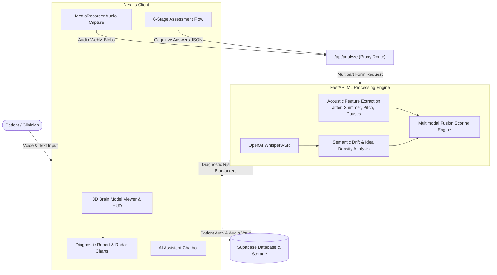

<div align="center">

# 🧠 AlzDetect — Multimodal Alzheimer's Early Detection

**An advanced clinical AI platform fusing acoustic speech biomarkers, linguistic semantics, and cognitive memory tasks for non-invasive, early-stage cognitive impairment screening.**

[](https://nextjs.org/)
[](https://react.dev/)
[](https://fastapi.tiangolo.com/)
[](https://tailwindcss.com/)
[](https://threejs.org/)
[](https://pytorch.org/)
[](https://github.com/openai/whisper)
[](https://supabase.com/)

</div>

---

## 📌 Table of Contents
- [Overview](#-overview)
- [Key Features](#-key-features)
- [Clinical Assessment Protocol](#-clinical-assessment-protocol)
- [Architecture](#-architecture)
- [Tech Stack](#-tech-stack)
- [Project Structure](#-project-structure)
- [Getting Started](#-getting-started)
  - [Prerequisites](#prerequisites)
  - [Backend Setup](#1-backend-setup-fastapi)
  - [Frontend Setup](#2-frontend-setup-nextjs)
- [Environment Variables](#-environment-variables)
- [Disclaimer](#-clinical-disclaimer)

---

## 🔬 Overview

Alzheimer's Disease (AD) and Mild Cognitive Impairment (MCI) are often detected years after irreversible neurodegeneration has already begun. **AlzDetect** bridges this gap by combining non-invasive digital biomarkers into an intelligent multimodal screening pipeline:

1. **Acoustic Speech Biomarkers**: Micro-variations in vocal pitch, speech pauses, acoustic jitter, and shimmer.
2. **Linguistic & Semantic Drift**: Transcribed natural speech evaluated for vocabulary richness, idea density, and syntactic coherence using transformer language models (BERT) and OpenAI Whisper.
3. **Digitized Neuropsychological Tasks**: Immediate recall, semantic categorical fluency, paired-associate associative learning, and delayed recall simulating gold-standard assessments (MMSE & MoCA).

---

## ✨ Key Features

- **Interactive 3D Neuro-Anatomy Viewer**:
  - WebGL/Three.js interactive 3D cortical model (`/brain_project.glb`) featuring smooth continuous auto-rotation, mouse drag interaction, and automatic vertical axis realignment.
  - Floating clinical telemetry HUD with live signal metrics and confidence meters.
- **6-Stage Standardized Cognitive Battery**:
  - Seamless guided workflow capturing both spontaneous voice audio and typed cognitive responses.
- **Multi-Scene Picture Description Stimuli**:
  - Curated set of high-contrast line-art stimulus scenes (including the standard *Boston Diagnostic Aphasia Examination* "Cookie Theft" scene, living room, seaside, bakery, and picnic scenes) designed to elicit natural, spontaneous narrative speech.
- **Dynamic Multimodal Risk Stratification**:
  - Weighted fusion engine balancing memory retrieval scores and speech-language features to compute an overall cognitive risk index and confidence percentage.
- **Comprehensive Diagnostic Report**:
  - Detailed post-assessment report featuring interactive Recharts radar visualizations, baseline comparisons, and granular clinical breakdowns.
- **Integrated AI Assistant**:
  - Embedded conversational agent powered by Google Gemini for patient orientation, instructions, and cognitive health inquiries.
- **Secure Architecture**:
  - End-to-end patient profile management, session tracking, and audio storage powered by Supabase Auth and Storage.

---

## 📋 Clinical Assessment Protocol

The assessment protocol consists of 6 sequential, clinically grounded sub-tests:

| Step | Test Name | Target Cognitive Domain | Evaluation Metric |
| :---: | :--- | :--- | :--- |
| **1** | **Paragraph Reading** | Acoustic phonetics & articulatory motor control | Speech rate, pitch variance, micro-pauses, vocal jitter & shimmer |
| **2** | **Immediate Word Recall** | Immediate working & episodic memory | Noun recall accuracy (MoCA/MMSE 5-word pools) |
| **3** | **Verbal Fluency** | Executive function & semantic retrieval speed | 60-second timed categorical listing across 18 clinical categories |
| **4** | **Picture Description** | Spontaneous speech & conceptual retrieval | Narrative idea density, semantic drift, and vocabulary complexity |
| **5** | **Paired Associate Learning** | Associative memory & cued retrieval | Unrelated cue-target word pair recollection |
| **6** | **Delayed Word Recall** | Long-term memory consolidation & delayed retrieval | Retention accuracy of initial 5-word list after cognitive interference |

---

## 🏛 Architecture



---

## 💻 Tech Stack

### Frontend
- **Framework**: [Next.js 16 (App Router)](https://nextjs.org/)
- **Core Library**: [React 19](https://react.dev/)
- **Styling**: [Tailwind CSS v4](https://tailwindcss.com/)
- **3D Graphics**: [Three.js](https://threejs.org/) with OrbitControls & GLTFLoader
- **Animations**: [Framer Motion](https://www.framer.com/motion/) & [GSAP](https://gsap.com/)
- **Data Visualization**: [Recharts](https://recharts.org/)
- **Icons**: [Lucide React](https://lucide.dev/)
- **Typography**: [Geist](https://vercel.com/font), Plus Jakarta Sans & Outfit
- **Database & Auth**: [@supabase/supabase-js](https://supabase.com/) & [@supabase/ssr](https://supabase.com/docs/guides/auth/server-side)

### Backend
- **Framework**: [FastAPI](https://fastapi.tiangolo.com/) (Python 3.10+)
- **Server**: [Uvicorn](https://www.uvicorn.org/)
- **Speech-to-Text**: [OpenAI Whisper](https://github.com/openai/whisper)
- **Audio Processing**: [librosa](https://librosa.org/), [soundfile](https://pysoundfile.readthedocs.io/), [scipy](https://scipy.org/)
- **NLP / Embeddings**: [PyTorch](https://pytorch.org/), [transformers](https://huggingface.co/docs/transformers), [rapidfuzz](https://github.com/rapidfuzz/RapidFuzz)
- **LLM Integration**: [@google/generative-ai](https://ai.google.dev/) (Gemini)

---

## 📂 Project Structure

```text
Alzhimer-Detector/
├── Alzhimer-Detector-Backend/       # FastAPI Machine Learning Service
│   ├── main.py                      # Core analysis pipeline & REST endpoints
│   ├── requirements.txt             # Python dependencies
│   └── start_ngrok.py               # Optional tunneling utility
│
├── Alzhimer-Detector-Frontend/      # Next.js 16 Web Application
│   ├── public/                      # Static assets, 3D GLTF models, assessment stimulus images
│   │   ├── brain_project.glb        # Interactive 3D brain model
│   │   ├── cookie_theft.png         # BDAE picture description stimulus
│   │   ├── living_room_scene.jpg    # BDAE style stimulus scene
│   │   ├── beach_scene.jpg          # BDAE style stimulus scene
│   │   └── bakery_scene.jpg         # BDAE style stimulus scene
│   └── src/
│       ├── app/
│       │   ├── page.tsx             # Hero section with 3D model & clinical telemetry
│       │   ├── assessment/page.tsx  # 6-step cognitive assessment runner
│       │   ├── results/page.tsx     # Diagnostic dashboard & biomarker visualization
│       │   ├── patient-info/        # Patient intake form
│       │   ├── login/               # Supabase authentication
│       │   └── api/analyze/         # API proxy routing to Python backend
│       ├── components/
│       │   ├── BrainModelViewer.tsx # Three.js interactive canvas component
│       │   ├── Chatbot.tsx          # Gemini-powered medical AI assistant
│       │   └── ui/                  # Fluid flow canvas & layout primitives
│       └── utils/supabase/          # Client & server Supabase connectors
│
├── .gitignore                       # Repository-wide ignore rules
└── README.md                        # Documentation
```

---

## 🚀 Getting Started

### Prerequisites
- **Node.js**: v18.17+ or v20+
- **Python**: v3.10+
- **ffmpeg**: Required for audio decoding in Whisper/librosa
- **Git**

---

### 1. Backend Setup (FastAPI)

1. Open a terminal and navigate to the backend directory:
   ```bash
   cd Alzhimer-Detector-Backend
   ```

2. Create and activate a Python virtual environment:
   ```bash
   # Windows (PowerShell)
   python -m venv venv
   .\venv\Scripts\Activate.ps1

   # macOS / Linux
   python3 -m venv venv
   source venv/bin/activate
   ```

3. Install required Python packages:
   ```bash
   pip install -r requirements.txt
   ```

4. Start the development server:
   ```bash
   python -m uvicorn main:app --reload --port 8000
   ```
   *The FastAPI documentation is accessible at `http://localhost:8000/docs`.*

---

### 2. Frontend Setup (Next.js)

1. Open a second terminal and navigate to the frontend directory:
   ```bash
   cd Alzhimer-Detector-Frontend
   ```

2. Install dependencies:
   ```bash
   npm install
   ```

3. Configure your local environment variables in `.env.local` (see template below).

4. Launch the Next.js development server:
   ```bash
   npm run dev
   ```
   *The frontend application is accessible at `http://localhost:3000`.*

---

## 🔐 Environment Variables

### Frontend (`Alzhimer-Detector-Frontend/.env.local`)
```env
# Supabase Configuration
NEXT_PUBLIC_SUPABASE_URL=https://your-project.supabase.co
NEXT_PUBLIC_SUPABASE_ANON_KEY=your-supabase-anon-key

# Backend API Endpoint
NEXT_PUBLIC_BACKEND_URL=http://localhost:8000

# Google Gemini API (for AI Assistant)
NEXT_PUBLIC_GEMINI_API_KEY=your-gemini-api-key
```

### Backend (`Alzhimer-Detector-Backend/.env`)
```env
# Optional configuration for local models or Cloudflare tunnels
FAST_MODE=true
```

---

## ⚕️ Clinical Disclaimer

> **IMPORTANT NOTICE:**  
> This software is developed for research and educational purposes to explore multimodal digital biomarkers for early cognitive change detection. It is **not** a certified medical diagnostic device and should **not** replace formal clinical evaluations, neuropsychological testing, or professional medical diagnosis by licensed healthcare providers.
